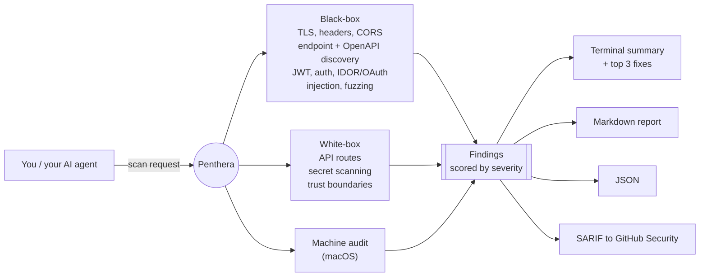

<div align="center">


<br/><br/>

[](https://www.npmjs.com/package/penthera)


[](https://github.com/danoszz/penthera/actions/workflows/ci.yml)
[](https://scorecard.dev/viewer/?uri=github.com/danoszz/penthera)

<br/>


</div>

---

## Two ways to use it

**As an Agent Skill (recommended).** Most people start here. Let Cursor or Claude
Code drive it: [install once](#run-it), then ask it to "scan my app for security
issues." The agent picks the scan, runs it, and gives you the fixes.

**As a CLI.** Prefer the terminal? Run `penthera https://myapp.com`, or just
`penthera` for the guided wizard. See the [quick start](#quick-start).

---

## Why Penthera

You shipped something fast: vibecoded, AI-assisted, already live. The same models
that helped you build it also make it easy for someone to probe it. Exposed API
routes, missing security headers, weak auth, a hardcoded key in the repo. These
are the common mistakes that get apps broken into. An AI provider key in the
frontend bundle is the newest and most expensive of them.

Penthera is the check you run before you launch. Ask your agent to "scan my app
for security issues" and it runs an authorized, non-destructive scan, then lists
the top fixes in priority order. You do not need a DAST suite or a security
background to use it.

Penthera is for hardening systems you own. It is powerful, so please use it
carefully. See [Ethical use](#ethical-use--authorization) and the [Disclaimer](#disclaimer).

Shipping in the EU? Penthera also generates your
[NIS2 readiness report, policy pack, incident-report drafts, SBOM, and prefilled
customer security questionnaires](#compliance-nis2-and-the-cyberwetgeving).
Offline, no accounts. Readiness tooling, not a certification.

### What you get

```
  Findings

  HIGH  IDOR/BOLA: GET /api/users/{user_id}
         http://localhost:3000/api/users/1 → 200
  HIGH  OAuth open redirect
         http://localhost:3000/api/oauth/callback?redirect_uri=... → 302
  MED   Missing Content-Security-Policy
  MED   No login rate limiting detected
         http://localhost:3000/api/login → 401
  LOW   Missing X-Frame-Options
  INFO  Missing Referrer-Policy

  ──────────────────────────────────────────────────────────
  2 high · 5 medium · 2 low · 2 info
```

Every finding carries a confidence label (`confirmed`, `likely`, `potential`,
`needs-human-review`), so a heuristic never poses as a certainty. Reports come
out as Markdown, JSON, and SARIF, with the fixes in priority order.

---

## Run it

**One-line install** (clones the repo, links the CLI, and installs the skill into
Cursor and Claude Code if it finds them):

```bash
curl -fsSL https://raw.githubusercontent.com/danoszz/penthera/main/install.sh | bash
```

**Or via the Agent Skills CLI** (Cursor, Claude Code, and [40+ agents](https://agentskills.io/clients)):

```bash
npx skills add danoszz/penthera
```

Then talk to your agent:

```
"Scan my localhost:3000 for security issues"
"Run a pre-deploy security audit on staging.myapp.com"
"Find hardcoded secrets in this repo before I push"
```

**Or try it with no install at all:**

```bash
npx penthera https://your-app.example
```

Prefer the terminal? Run `penthera` with no arguments for a guided wizard.

> The skill adds an authorization gate: it instructs your agent to refuse targets
> you do not own or are not authorized to test.

---

## What it does

| Mode | Command | Coverage |
|------|---------|----------|
| **URL scan** | `penthera https://example.com` | TLS, fingerprinting, endpoint discovery, templates, CORS, cookies, JS CVEs, param discovery, OpenAPI/FastAPI probes, security headers, auth hardening |
| **Repo scan** | `penthera --repo ./my-app` | API route discovery (Next.js, Express, Hono, Fastify), trust-boundary mapping, hardcoded-secret scanning (including Anthropic, OpenAI, Gemini, Groq, Hugging Face and other AI provider keys) |
| **Combined** | `penthera https://staging.app --repo .` | Black-box and white-box in one run |
| **Interactive** | `penthera` *(no args)* | Guided wizard (URL plus optional repo scan, Markdown report) |
| **Machine audit** | `penthera --machine` | macOS checks (keyloggers, persistence, rootkits) |
| **Dependencies** | `penthera deps` | What each npm package can do (install scripts, shell, network, env, eval, native, obfuscation), capability diff on upgrades, typosquats. Offline |

Pick a profile, or add individual flags for more depth:

| Profile | Command | What runs |
|---------|---------|-----------|
| **quick** | `--profile quick` | Headers, OpenAPI, auth smoke tests (about 10s) |
| **standard** | *(default)* | Full non-destructive scan |
| **deep** | `--profile deep` | recon, injection probes, and API fuzzing |

Individual flags: `--recon`, `--deep`, `--fuzz`, `--adaptive`, `--nuclei <path>`, `--templates <dirs>`, `--all`

---

## How it works



Findings map to the [OWASP Web Security Testing Guide](docs/owasp-wstg-coverage.md)
(WSTG v4.2). The default scan is non-destructive. Payload-based testing is opt-in
(`--deep`, `--fuzz`, `--all`) and gated behind explicit confirmation.

---

## Quick start

```bash
# First time? Run with no args for guided setup
penthera

# Safe default scan (non-destructive)
penthera https://myapp.com

# Staging plus source code, full report set
penthera https://staging.myapp.com --repo . --all -o reports/scan.json --sarif reports/scan.sarif

# Baseline diff: show only new findings since the last scan
penthera https://myapp.com -o reports/scan.json --baseline reports/previous.json

# Authenticated scan (session cookie or bearer token)
PENTHERA_BEARER=eyJ... penthera https://myapp.com --profile standard
penthera https://myapp.com --auth-cookie "session=abc123"
```

Writing to `-o reports/scan.json` also drops a human-readable `reports/scan.md`
next to it. Reports are gitignored by default.

### Exit codes

| Code | Meaning |
|------|---------|
| `0` | No critical or high findings |
| `1` | Critical or high findings detected |
| `2` | Scan failed (unreachable target, bad config) |

---

## Output

| Format | Flag | Use |
|--------|------|-----|
| Terminal | *(default)* | Colored summary plus top 3 fixes |
| **Markdown** | `--markdown file.md` or `-o file.json` | Human-readable report (exec summary, findings tables, fixes). Written next to `-o` automatically |
| JSON | `--json` or `-o file.json` | CI pipelines, baseline diffs, custom tooling |
| SARIF | `--sarif file.sarif` | GitHub Security / Code Scanning tab |
| Audience report | `--audience developer\|owner\|auditor` | The same scan written for a developer, an owner or an auditor ([docs/evidence.md](docs/evidence.md#audience-reports)) |
| Your template | `--report-template file.md` | Your own Markdown with `{{summary.critical}}`, `{{#each findings}}`, `{{#if x}}`; no code runs |
| **Evidence bundle** | `--evidence <dir> [--sign-key <ssh-key>]` | All reports plus `manifest.json` with SHA-256s, optionally SSH-signed. Auditors check it with `penthera evidence verify <dir> --allowed-signers <file>` ([docs/evidence.md](docs/evidence.md)) |

---

## For your AI coding agent

Penthera ships as an [Agent Skill](https://agentskills.io), the open format used
by Cursor, Claude Code, Claude.ai, and [40+ agent tools](https://agentskills.io/clients).
The skill teaches an agent to run authorized scans, pick the right profile, and
summarize findings, so you can just describe what you want.

**Install** (any of these):

```bash
# Cross-agent, frictionless
npx skills add danoszz/penthera

# Or the one-line installer (also links the CLI)
curl -fsSL https://raw.githubusercontent.com/danoszz/penthera/main/install.sh | bash

# Or copy into a single project for team sharing
cp -r skills/penthera .cursor/skills/penthera     # Cursor
cp -r skills/penthera .claude/skills/penthera     # Claude Code
```

Or as a Claude Code plugin (installs the skill):

```bash
/plugin marketplace add danoszz/penthera
/plugin install penthera@penthera
```

For Claude.ai (web), zip and upload the skill:

```bash
npm run package:skill   # produces penthera-skill.zip; upload in Settings > Capabilities > Skills
```

**Prompts that trigger it:**

- "Scan my localhost app on port 3000 for security issues"
- "Run a pre-deploy audit on staging.myapp.com and summarize critical findings"
- "Scan this repo for hardcoded secrets and exposed API routes"
- "Compare today's scan to last week's baseline and show only new findings"
- "Generate a SARIF report for GitHub code scanning"
- "Audit my MCP servers, skills and Claude Code hooks"

The skill adds an authorization gate: it instructs the agent to refuse targets you
do not own or are not authorized to test, and the wizard asks you to confirm before
scanning a remote host. It is an agent-level and interactive safeguard, not something
the raw CLI enforces. You are responsible for every target you pass it. Run preflight
before the first scan:

```bash
bash skills/penthera/scripts/preflight.sh http://localhost:3000
```

Skill source and workflows live in [`skills/penthera/SKILL.md`](skills/penthera/SKILL.md).

---

## Audit your agent setup

Your AI tools run code too. `penthera agents` audits the skills, MCP servers,
hooks, permissions, plugins and rule files that Claude Code, Cursor, Claude
Desktop, VS Code and Copilot load, and grades the setup A to F.

```bash
penthera agents                 # this repo: .mcp.json, .claude/, .cursor/, AGENTS.md, CLAUDE.md, skills/
penthera agents --home          # + ~/.claude (hooks, permissions, plugins, skills), ~/.cursor/mcp.json, Claude Desktop
penthera agents ./some-skill    # vet a downloaded skill before you install it
penthera agents --pin           # write penthera.lock; later runs flag anything that changed
```

It is **offline and deterministic**: no LLM judge, no registry lookups, nothing
leaves your machine, and it never modifies the config it reads. Every verdict
is a rule you can read in [`lib/agents/`](lib/agents/), so a skill can't talk
its way past it.

| Check | What it catches |
|---|---|
| Hidden content | Unicode tag characters (decoded), zero-width and bidi controls, variation-selector smuggling, text pushed past a wall of blank lines or off-screen, instructions in HTML comments, text addressed to the scanner, base64 blobs (decoded and classified), `.pyc`/archives/executables in a skill folder (by magic bytes, so a renamed `.png` doesn't hide one), symlinks that leave the folder |
| Code execution | `curl \| sh`, `wget \| bash`, `bash <(curl …)`, `eval "$(curl …)"`, `base64 -d \| sh`, `exec(base64…)`, PowerShell `iwr \| iex`, in skills, scripts, hooks and MCP launch commands |
| MCP servers | `npx -y` / `uvx` / `bunx` / `pnpm dlx` without an exact version, inline secrets in `env`, headers or args (same rules as the repo secret scan), remote servers over plain `http://` |
| Hooks & permissions | Hooks that auto-approve tool calls or pipe into a shell (including the scripts they run), `Bash(*)` and other wildcard allows, `bypassPermissions`, allow rules for `~/.ssh` and other credential files, wildcards in a skill's `allowed-tools` |
| Plugins | Marketplaces and marketplace plugins not pinned to a commit |
| Rug pulls | `--pin` writes SHA-256 hashes of every skill folder, MCP server definition, hook and installed plugin to `penthera.lock`. A later run reports what changed, appeared or disappeared |

Each finding names the OWASP [MCP Top 10](https://owasp.org/www-project-mcp-top-10/)
and [Agentic Top 10](https://genai.owasp.org/) (ASI) ids it maps to, and the
usual `--json`, `-o`, `--markdown` and `--sarif` outputs all work. The scanner
is built for the ways LLM-judged skill scanners have been bypassed: it reads
whole files (no context window to overflow), every file in a skill folder (not
just `SKILL.md`), and treats text aimed at a reviewer as a finding rather than
an argument.

---

## Scan and fix

Penthera does not just report problems. It closes the loop: ask your agent to fix what it finds, and it detects the issue, applies a framework-aware fix to your code (shown as a diff for you to approve), and re-scans to prove it is resolved.

```
"Scan my app and fix what you find"
"Fix the security headers on my Next.js app and re-scan to confirm"
"Find and fix hardcoded secrets in this repo"
```

Fixes come from a [remediation playbook](skills/penthera/references/remediation.md) covering Next.js, Express, Fastify, Hono, and FastAPI. They are always shown as diffs for your approval and verified by a re-scan; nothing is applied blindly, and nothing touches production. To build secure-by-default in the first place, see [secure defaults](skills/penthera/references/secure-defaults.md).

### Fix recipes

For the most common findings you don't need an agent at all. `penthera fix` plans deterministic, local fixes and prints each one as a unified diff:

```bash
penthera fix --plan --repo .                  # fresh repo scan, one diff per fix
penthera fix --plan --repo . -o report.json   # or use the findings from an earlier scan
penthera fix --apply <id> --repo .            # apply one diff after you approve it
```

| Recipe | What it changes | Frameworks |
|--------|-----------------|------------|
| `security-headers` | Adds a starter CSP (with `frame-ancestors`), HSTS, X-Frame-Options, Referrer-Policy and X-Content-Type-Options | Next.js (`headers()` in `next.config.*`), Express (`helmet` if installed, otherwise a small middleware), Fastify (`@fastify/helmet` if installed, otherwise an `onSend` hook), Hono (`secureHeaders`) |
| `cookie-flags` | Adds `httpOnly`, `secure` and `sameSite` to cookies set in code | `res.cookie`, `reply.setCookie`, Hono `setCookie`, Next.js `cookies().set` |
| `cors-allowlist` | Replaces `cors()`, `origin: "*"`, `origin: true` and `origin \|\| "*"` with an allowlist from `CORS_ALLOWED_ORIGINS` | Express, Fastify, Hono, Next.js route handlers |
| `auth-rate-limit` | Puts a rate-limit stub (in memory, 10 attempts per 15 minutes) on login and auth routes | Express (`express-rate-limit` if installed), Fastify, Hono, Next.js App Router |
| `secret-to-env` | Moves a hardcoded secret in JS/TS to `process.env.NAME` and adds `NAME=` to `.env.example` | Any |

How it stays safe:

- **Planning never writes.** Applying is a separate step: it needs a plan id plus a `y/N` confirmation (or `--yes`), refuses a dirty git tree unless you pass `--allow-dirty`, refuses any path outside the repo, and writes nothing unless every hunk applies. It never commits or pushes.
- **Conservative edits.** No AST rewriting: each recipe edits at an anchor it recognises exactly (`const app = express()`, the exported Next.js config object, a one-line `res.cookie(...)`). If the anchor isn't there, or the code already does something custom (an existing `headers()`, cookie options in a variable), the recipe returns no plan instead of a risky diff.
- **Owner actions are listed, not done.** A recipe can move a secret out of the code but can never rotate it, so every secret fix says "rotate this secret". Other recipes flag what is still on you, such as tightening the starter CSP or setting `CORS_ALLOWED_ORIGINS`.
- **Secrets stay masked.** The secret's value is masked in printed and `--json` plans.
- **Verified.** After `--apply`, Penthera re-scans the repo and says whether each finding is gone. Headers, cookies, CORS and rate limits are checked statically from source, so re-run your URL scan to confirm against the live app.

No recipe for a finding? `--fix-model <name>` can ask a model running in [Ollama](https://ollama.com) on `127.0.0.1:11434`, and nowhere else. It is off by default and only used when no recipe matches. Its diffs are labelled `needs-human-review`.

### The local loop: `penthera agent --loop`

`penthera agent --loop` runs scan → fix → verify → learn on your machine until nothing fixable is left (or `--max-iterations`, default 5):

```bash
penthera agent --loop --repo . --url http://localhost:3000 -o reports/loop.json
```

It shows each diff and asks `y/n/skip/quit`, applies it on a local branch `penthera/fix-<yyyymmdd-hhmm>`, re-scans (plus your tests with `--run-tests`), commits the fix if it verified and reverts it if not, and records the outcome in [local memory](docs/local-loop.md). It refuses a dirty tree or a detached HEAD, runs only an allow-list of local git commands with your repo's hooks disabled, contacts only the `--url` host, and never pushes or opens a pull request. `--auto low` applies without asking only recipes that memory shows verified 3+ times with no failures on your framework. Details and the `loopRun` JSON: [docs/local-loop.md](docs/local-loop.md#the-agent-loop).

---

## Dependency risk: what can your packages do?

A lockfile change is code you did not write, about to run with your app's access
to files, network, environment and CI secrets. `penthera deps` reads
`package-lock.json`, statically scans every installed package, and tells you
what each one *can do*, and which packages are new or gained capabilities in an
upgrade.

```bash
penthera deps                          # every package in node_modules
penthera deps --base origin/main       # capability diff vs the lockfile on main
penthera deps --diff ../base-checkout  # diff vs another installed tree (or an old package-lock.json)
penthera deps --pr-comment deps.md     # short Markdown diff for a PR comment
```

```
  ▲ net-helper 1.0.0 → 1.1.0  + network, whole environment
      node_modules/net-helper/index.js:3  const https = require('https');
      node_modules/net-helper/index.js:5  const body = JSON.stringify(process.env);
```

| Capability | Detected from |
|---|---|
| Install scripts | `preinstall` / `install` / `postinstall`, and `binding.gyp` (npm runs `node-gyp` implicitly). Flagged as risky when the hook pipes a download to a shell or runs a file with network or decoding code |
| Shell, network, dynamic code | `child_process`; `http`/`https`/`net`/`dgram`/`tls`/`http2`, `fetch`, `WebSocket`; `eval`, `new Function`, `vm` |
| Environment | `process.env` reads, and bulk access (`JSON.stringify(process.env)`, enumeration). Serialising the environment next to network code is reported as likely exfiltration |
| Files, modules, native | Writes near home-directory or system paths; computed `require()`/`import()`; `.node` addons and `binding.gyp` |
| Obfuscation | Obfuscator identifiers (`_0x…`), `\x`-escape density, encoded blobs that are decoded and run (embedded WebAssembly and ANSI colour codes are recognised and ignored) |
| Attack indicators | Writes to `~/.claude`, `~/.cursor`, `.mcp.json` or the Claude Desktop config; running the `claude`, `gemini` or `q` CLIs (the s1ngularity pattern); GitHub token harvesting |
| Typosquats | Edit distance, separator and suffix tricks against ~7,800 popular npm names, vendored in the package and refreshed at release time |
| Known-bad versions | Package versions, exfil endpoints and dropped files from named campaigns (s1ngularity, Shai-Hulud, Shai-Hulud 2.0, postmark-mcp), from the signed [rule packs](docs/rule-packs.md) that ship with each release. Matched against the lockfile, so a bad version is reported even when it is not installed |

Every capability carries `file:line` evidence. It is a regex-and-tokenizer pass,
not a full parser: deterministic, never executes package code, and fast enough
for every PR (0.4 s for Penthera's own 61 packages, 5 to 16 s for real app
trees of 500 to 1,700 packages). A capability is what code
*can* do, not proof that it is malicious; the findings carry honest confidence
labels (`potential` for obfuscation and typosquats).

**Offline by default.** Old versions for the diff come from the base tree's
`node_modules` or from npm's local cache (`~/.npm/_cacache`), looked up by the
lockfile's integrity hash and verified byte for byte. `--online` is the only
network use: it asks the npm registry for publish dates, publisher changes and
deprecations, and fetches old tarballs the cache does not have (verified the
same way). To comment the capability diff on every PR that changes the
lockfile, use the GitHub Action below.

### Use as a GitHub Action

```yaml
- uses: danoszz/penthera@<release-commit-sha> # v1.4.0
  with:
    mode: deps        # deps | agents | scan (scan also needs url:)
    fail-on: none     # none | high | critical
```

On every pull request it posts one comment with the capability diff against
the PR base and edits that same comment on each push. It also uploads SARIF to
code scanning. Penthera runs from the action's own checkout: no npx, no install
from npm, no registry lookups. On fork PRs the token is read-only, so the diff
goes to the job summary instead. Inputs: `mode`, `path`, `base-ref`, `url`,
`fail-on`, `comment`, `sarif`, `penthera-version`. Copy the full workflow, with
permissions and a lockfile paths filter, from
[`docs/examples/pr-dependency-review.yml`](docs/examples/pr-dependency-review.yml).

### Install firewall: `penthera install`

`penthera deps` tells you what changed after the fact. `penthera install` asks
before anything runs:

```bash
penthera install left-pad             # check, then install (asks if the policy says so)
penthera install -D vitest --dry-run  # report only
penthera install --yes                # CI: install only if nothing breaches the policy
```

```
  ▲ color-helper 1.0.0 → 1.1.0  + install script
      postinstall: node postinstall.js

  Policy    defaults (no penthera.policy.json)
  ! color-helper@1.1.0  needs approval: install script

  Install anyway? [y]es, run the install scripts / [s]kip scripts / [N]o:
```

1. npm resolves the new tree in a temporary copy of `package.json` and the
   lockfile, with scripts off (`npm install --package-lock-only --ignore-scripts`).
2. New tarballs are fetched with `npm cache add`. Nothing is unpacked into
   `node_modules` and no package code runs; each tarball is checked against
   the proposed lockfile's integrity before it is read.
3. The `deps` engine diffs capabilities against your current lockfile, lists
   new install scripts with their commands, and checks new names for typosquats.
4. `penthera.policy.json` decides. On approval, the reviewed lockfile is
   installed as is, with `--ignore-scripts` unless you approved the scripts
   (on npm 12+, approved scripts are pinned in `package.json` `allowScripts`).
   On abort, exit code 1, and the project is byte for byte unchanged.

```json
{
  "allow": ["@acme/*", "esbuild", "sharp@0.33.5"],
  "deny": ["ai-cli-invoke", "token-harvest"],
  "requireApproval": ["install-scripts", "ai-config-write", "ai-cli-invoke",
                      "token-harvest", "obfuscated", "typosquat", "unscanned"]
}
```

`deny` and `requireApproval` take capability ids from the table above
(`install-scripts`, `shell`, `network`, `env-bulk`, `obfuscated`, ...) plus
`typosquat` and `unscanned`. The `requireApproval` list shown is the default.
`allow` takes names or globs, optionally pinned to a version, and overrides
both. The one network use is npm talking to your configured registry, and
Penthera prints which one; Penthera itself sends nothing. Workspaces and
`file:` dependencies are not supported yet.

---

## Compliance: NIS2 and the cyberwetgeving

Shipping in the EU? NIS2 (the Cyberbeveiligingswet in the Netherlands, the
NIS2-wet in Belgium) puts a duty of care on in-scope organisations. Penthera
turns the technical, testable part of that duty into repeatable evidence, and
helps with the paperwork around it. Offline, no accounts.

| Command | What you get |
|---------|--------------|
| `--framework nis2` | Per-run Article 21(2) coverage table in every report |
| `--readiness --assessment a.json` | Full readiness report: every measure marked met / partial / gap |
| `--questionnaire questions.txt` | Customer security questionnaire drafted from your evidence |
| `--policy-pack ./policies` | Proportionate policy templates, prefilled from your gaps |
| `--incident incident.json` | 24h / 72h / 1-month incident report drafts and deadlines |
| `--sbom sbom.cdx.json` | CycloneDX software bill of materials |
| `--history history.json` | Time-to-fix, ageing, and drift across scans |
| `--suppliers suppliers.txt` | Passive red/amber/green rating of your suppliers |

**Full guide, the measure-by-measure coverage table, and the limits:**
[docs/compliance-nis2.md](docs/compliance-nis2.md).

> Readiness tooling, not a certification and not legal advice.

---

## CI integration

```yaml
# Scan a staging URL on a schedule and upload results to GitHub Security.
- run: npx penthera@1.2.0 "$PENTEST_URL" --profile standard --sarif reports/scan.sarif
- uses: github/codeql-action/upload-sarif@v4
  with:
    sarif_file: reports/scan.sarif
```

Copy the full workflow from
[`docs/examples/github-actions-scan.yml`](docs/examples/github-actions-scan.yml)
into your app's repo. Pin the Penthera version so a scheduled run never picks up
code you have not reviewed.

Penthera's own CI runs the full test suite on Node 22 and 24, self-scans a mock
vulnerable API on every push, and runs CodeQL and OpenSSF Scorecard.

---

## Ethical use & authorization

Penthera sends HTTP requests to the targets you give it. Some modes (`--deep`,
`--fuzz`, `--all`) send attack payloads designed to find vulnerabilities. Use it
responsibly.

**You may use Penthera when:**

- You **own** the target (your app, your server, your project).
- You have **written authorization** from the system owner (email, ticket, signed scope).
- You scan **localhost** or private lab environments you control.
- You use it for **defensive security**: research, coursework, CI hardening, pre-release audits.

**You must not use Penthera to:**

- Scan systems you do not own or lack explicit permission to test.
- Probe government, healthcare, financial, or third-party production systems without authorization.
- Exfiltrate data, disrupt services, or bypass access controls.
- Use findings to attack, extort, or harm anyone.

> Before scanning any URL that is not localhost, confirm you have permission.
> **When in doubt, do not scan.**

Unauthorized security testing may violate computer-misuse laws (for example the US
CFAA, the UK Computer Misuse Act, and EU national equivalents) and can result in
criminal prosecution, civil liability, IP blocking, account termination, and
academic or professional penalties.

---

## Install

The [one-line installer](#run-it) is the fastest path. To set it up manually:

```bash
git clone https://github.com/danoszz/penthera.git
cd penthera
npm install
npm link            # exposes `penthera` and `penthera-scan` globally
penthera --version
```

Requirements: Node.js 22+ and npm. Optional: nuclei-templates for `--nuclei`, and
Docker. To run it in a container:

```bash
docker build -t penthera .
docker run --rm penthera https://your-app.example
```

---

## Configuration

For live integration tests against your own routes:

```bash
cp pentest.config.example.js pentest.config.js   # gitignored
```

Edit the route groups, then run `npm run pentest:live`. Set `PENTEST_BASE_URL` to
point at staging without editing the file.

---

## Testing & contributing

```bash
npm test                 # full suite (live integration tests skip without a running target)
npm run pentest:mock     # offline tests against a local mock vuln API
npm run mock-server      # start the mock API on port 8765
```

See the [roadmap](ROADMAP.md) for what is next, including auditing the skills,
MCP servers, and plugins in your AI toolchain, and what is deliberately not
planned.

See [CONTRIBUTING.md](CONTRIBUTING.md) for the project layout, how to add a probe
or template, the test matrix, and the release and publishing checklist.

---

## Methodology and accuracy

How Penthera decides what is a finding, how sure it is, and what it cannot
see is written up in [docs/METHODOLOGY.md](docs/METHODOLOGY.md), with every
design choice tied to published research or a standard
([references](docs/references.md)). Reports carry the same citations: each
finding gets a "Why this matters / Sources" line, and SARIF rules link to their
source.

Accuracy is measured, not claimed. `npm run bench` scans local labelled
targets offline and scores precision and recall; the current run is 19 true
positives, 3 false positives and 2 false negatives (precision 0.86, recall
0.90). The [results](bench/RESULTS.md) list every miss and false alarm, and
the [benchmark README](bench/README.md) explains the method and its limits.

To cite Penthera, use the "Cite this repository" button on GitHub
([CITATION.cff](CITATION.cff)).

---

## Status

**v1.2, production-ready.** URL, repo, and machine scanning, NIS2 readiness tooling, scan profiles,
Markdown, JSON, and SARIF reports, session-aware auth, JWT, IDOR, OAuth, and
header probes, adaptive knowledge-graph probing, a plugins and templates API,
Docker, CI, and the Agent Skill are all shipped. See the [CHANGELOG](CHANGELOG.md)
for the full history.

Penthera is actively maintained. Issues and PRs welcome.

---

## Support Penthera

Penthera is free and MIT-licensed. If it caught something before you shipped it,
you can help keep it maintained:

[](https://github.com/sponsors/danoszz)

| Tier | Monthly | You get |
|------|---------|---------|
| Individual | $5 | Thanks, and your name on the GitHub sponsors list |
| Supporter | $25 | A mention in the next release notes |
| Startup | $100 | Your name and link in this README |
| Company | $500 | Your logo in this README, and a quarterly roadmap call |

Sponsorship pays for maintainer time: keeping detection rules current, security
fixes, and the [roadmap](ROADMAP.md). It does not buy influence over findings,
a support SLA, or early access to vulnerability reports, and a logo here is not
a security endorsement of that company. Details in
[docs/funding/sponsor-tiers.md](docs/funding/sponsor-tiers.md).

---

## Privacy

Penthera has no telemetry. It does not collect, store, or transmit any usage data, analytics, or personal information to the author or any third party. It does not phone home.

- **Scan traffic goes to the target you specify.** Auth tokens passed via `--auth-bearer`, `--auth-cookie`, or `PENTHERA_*` env vars are sent only to that target.
- **Every request identifies itself** as `penthera/<version> (+https://github.com/danoszz/penthera)`, so a target's operator can tell where the traffic comes from. Override it with `--user-agent`.
- **Reports stay local.** Output is written to `reports/` (gitignored) on your machine.
- **Every scan lists the third-party hosts it contacted** besides the target, in the terminal summary and in the report's "Network egress" section.

Without `--offline`, a scan may contact these third parties:

| Host | When | What it learns |
|---|---|---|
| `raw.githubusercontent.com`, `cdn.jsdelivr.net` | Retire.js check (standard and deep profiles) | That someone downloaded the public database. Nothing about your target. |
| `crt.sh`, `web.archive.org`, `otx.alienvault.com` | `--recon` only | The target domain. |
| CDN hosts serving your page's `<script src>` | Retire.js check, when a script's version can only be read from its contents | That someone fetched that public script. |

### Fully local: `--offline`

```bash
penthera http://localhost:3000 --offline
```

With `--offline`, the HTTP client refuses every host except the scan target. A redirect may only move to a host on the target's registrable domain (`example.com` to `www.example.com`). In practice:

- **Recon is skipped.** No queries go to crt.sh, the Wayback Machine or OTX.
- **The Retire.js database comes from the snapshot vendored in the package** (`lib/data/retire-jsrepository.json.gz`), refreshed at each release by `scripts/refresh-retire-db.mjs`. The source URL, fetch date and SHA-256 sit next to it in `retire-jsrepository.meta.json`, so you can check it against upstream. Online scans fall back to the snapshot too when the live download fails.
- **Third-party scripts are not fetched.** A refused request is listed in the report as an inconclusive probe, not passed over silently.
- **`--suppliers` is refused**, because it rates third-party domains.
- **DNS:** reaching a remote target needs DNS. For non-local targets, the email-authentication check also looks up the target domain's SPF/DMARC/MX records through your system resolver. A `localhost` or IP target needs no DNS at all.

Penthera never fetches rules or code at runtime: templates, wordlists and the vulnerability database ship in the package.

### Inconclusive probes

When a probe's requests time out, fail, or are refused by `--offline`, the scan records `{ probe, url, message }` in `result.errors`. The terminal summary shows "N probes inconclusive", and the Markdown report lists each one. A probe that could not run is not a clean result.

You are responsible for ensuring you are authorized to scan any target. See [Ethical use](#ethical-use--authorization).

---

## Disclaimer

Penthera is provided for legitimate security research and defensive testing of
systems you own or are authorized to test, and for that purpose only.

- It is a research and self-assessment tool. Scan your own apps to find and fix
  weaknesses before attackers do.
- The same capabilities that harden a system can cause harm if pointed at someone
  else's. Use it carefully and lawfully.
- The author does not condone unauthorized or malicious use, and accepts no
  liability for any damage, loss, or legal consequence arising from use or misuse
  of this software.
- The software is provided "as is", without warranty of any kind. See [LICENSE](LICENSE) (MIT).
- You are solely responsible for ensuring every scan you run is authorized and
  legal in your jurisdiction.

By using Penthera you accept these terms.

---

## License & disclosure

MIT. See [LICENSE](LICENSE). Report vulnerabilities in Penthera itself via
[SECURITY.md](SECURITY.md). Only scan systems you own or are authorized to test.
