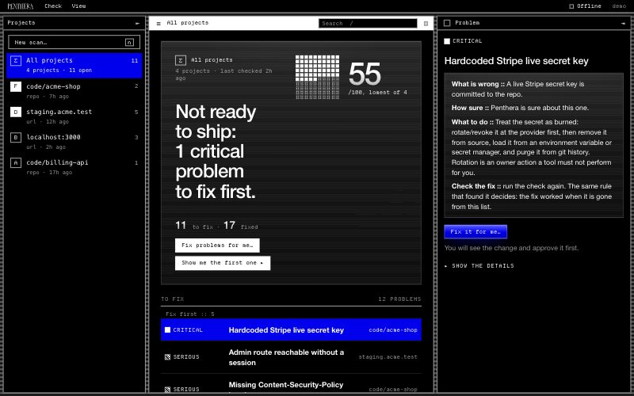
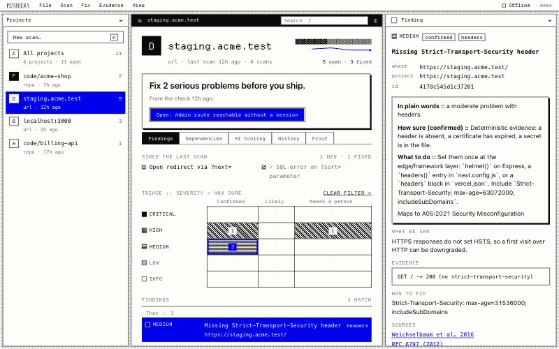
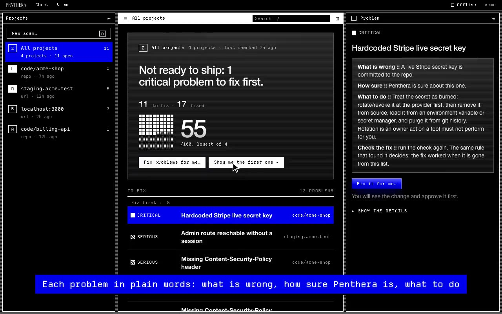
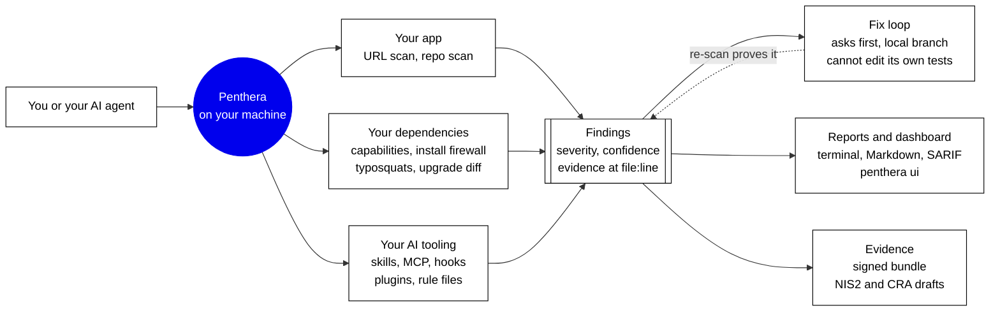

<div align="center">


<br/><br/>

**Penthera: your open-source cyber security agent**

The security review you never had time for. Offline, rule-based, and you can verify every finding yourself.

<br/>

[](https://www.npmjs.com/package/penthera)


[](https://github.com/danoszz/penthera/actions/workflows/ci.yml)
[](https://scorecard.dev/viewer/?uri=github.com/danoszz/penthera)

<br/>


<br/><br/>

| `penthera ui`, Simple, dark | `penthera ui`, Advanced, light |
|---|---|
|  |  |

<a href="assets/walkthrough.mp4"></a>

[Watch the 80-second walkthrough](assets/walkthrough.mp4): setup, a scan, the dashboard, a fix approved, the report. Demo data, no sound, captions in the video.

</div>

---

## What Penthera is

Teams ship apps and AI agents faster than anyone can check them, and most
security scanners offer no evidence of how well they actually work. Penthera is
an open-source R&D project that tackles both.

**Use it today.** A cyber security agent for your coding tools that runs
offline on your own machine: it checks your app, its dependencies and your AI
tooling, and fixes what it can with your approval, through a dashboard that
works for first-timers and pros alike.

**Trust it because it's measured.** Every check is tested in public,
pre-registered experiments, and the results are published, good or bad. What
holds up ships in the next release, so Penthera keeps pace with new attacks and
with EU rules such as NIS2 and the Cyber Resilience Act.

## Get started

One command in your project folder, no install, no account:

```bash
npx penthera
```

This is the guided start (`penthera init`). Penthera detects your setup
offline, asks what to check, and runs the code, dependency, and AI-tooling
checks. It scans your running app only after you confirm the app is yours. You
get a grade per area, the three things to fix first, and one report folder.
Then it offers, one yes or no at a time, the pre-commit hook, a CI workflow, and
the dashboard. Nothing is committed or pushed. Details are in
[docs/commands/init.md](docs/commands/init.md).

When you know what you want, run it directly:

```bash
npx penthera http://localhost:3000 --repo .   # scan the app you are about to ship, and its source
npx penthera deps                             # what can the packages in this project actually do?
npx penthera agents --home                    # audit your Claude Code, Cursor and MCP setup
npx penthera ui                               # open the local dashboard on 127.0.0.1
```

To let your coding agent drive it, add the Agent Skill, then ask "scan my app
for security issues" or "is this package safe to add?":

```bash
npx skills add danoszz/penthera
```

The skill tells your agent to refuse targets you do not own or are not
authorized to test. Other install routes (the one-line installer, the Claude
Code plugin, a per-project copy) are in [docs/commands/skill.md](docs/commands/skill.md).
Penthera needs Node.js 22 or later. To run it in a container:
`docker build -t penthera . && docker run --rm penthera https://your-app.example`.


## What it does



### Before you deploy

| Job | What Penthera does | Command |
|---|---|---|
| Test the app | Scans your localhost or preview URL (TLS, headers, CORS, auth, JWT, IDOR, OAuth, OpenAPI; injection and fuzzing on request) and your repository (routes, trust boundaries, secrets including AI keys) | [`penthera <url> --repo .`](docs/commands/scan.md) |
| Fix and verify | Applies deterministic fixes on a local branch, re-scans to prove they worked, and remembers the result. Never pushes | [`penthera agent --loop`](docs/commands/fix.md) |
| Block it at commit time | Stops secrets, risky agent config, and dependency changes before they are committed | [`penthera hook install`](docs/commands/hook.md) |

### What you build with

| Job | What Penthera does | Command |
|---|---|---|
| Vet dependencies | Shows what every npm and Python package can do (install scripts, shell, network, env, obfuscation), what an upgrade added, lookalike names, and licenses | [`penthera deps --base main`](docs/commands/deps.md) |
| Guard installs | Shows what a new package brings before any install script runs, and stops it under your policy | [`penthera install <pkg>`](docs/commands/install.md) |
| Review pull requests | Comments the dependency capability diff on every PR that touches the lockfile | [GitHub Action](docs/commands/action.md) |
| Audit your AI tooling | Checks skills, MCP servers, hooks, plugins, and rule files for hidden instructions, unpinned servers, over-broad permissions, and silent updates | [`penthera agents --home`](docs/commands/agents.md) |

### After you ship

| Job | What Penthera does | Command |
|---|---|---|
| Report and prove | Writes reports for developers, owners, and auditors; a hashed, signable evidence bundle; NIS2 and CRA readiness reports and drafts | [`penthera <url> --audience auditor --evidence out/`](docs/evidence.md) |
| See it all | A local dashboard on 127.0.0.1 with a Simple mode for non-programmers: a one-sentence verdict, problems in plain words, a guided setup, and the fix loop with Apply, Skip, and Stop per change. Advanced adds dependencies, AI tooling, history and evidence | [`penthera ui`](docs/dashboard.md) |
| Keep watching | Scheduled checks of your production for drift: certificates, headers, new endpoints, keys in bundles, new CVEs in your SBOM | on the [roadmap](ROADMAP.md) |

Every finding carries a severity, a confidence label (`confirmed`, `likely`,
`potential`, `needs-human-review`), its evidence, and the research behind it.
Reports come out as Markdown, JSON, and SARIF for GitHub code scanning. Exit
code `1` means critical or high findings. Every command and flag is in
[docs/commands/](docs/commands/README.md).

## How it is measured

Each feature goes through the same path: **method → evidence → tool.**

- **Method.** The [methodology](docs/METHODOLOGY.md) states the threat model,
  what black-box (HTTP) and white-box (source) analysis can and cannot see, the
  confidence model, and the false-positive controls on each probe. Each design
  choice cites the research or standard it rests on: 92 verified references, in
  APA style, in [docs/references.md](docs/references.md).
- **Evidence.** A benchmark runs on every release, and the release gate fails
  if precision or recall drops by more than 0.02. Experiments that decide what
  ships next are pre-registered in [docs/research/prereg/](docs/research/prereg/)
  before any data is collected, and the results are published either way.
- **Tool.** What holds up ships in a reviewed, signed release. What does not
  hold up is dropped, and the rules stay.

| Measure | Result today |
|---|---|
| Precision on the bundled benchmark | 0.88, 95% CI 0.69 to 0.96 (21 true positives, 3 false positives) |
| Recall on the bundled benchmark | 0.91, 95% CI 0.73 to 0.98 (2 misses, [each one explained](bench/RESULTS.md)) |
| Requests to non-loopback hosts during the benchmark | 0 |
| Detection rules, all readable | 14 URL scan templates, 20 secret and AI-key patterns, 15 dependency capabilities, 39 AI-tooling rules, 5 fix recipes |

These numbers come from 24 findings in small labs that we wrote ourselves, so
they catch regressions; they do not measure real-world accuracy. Measuring that
on real projects is experiment E1, the first step of the
[research plan](docs/vision-2.0.md). Intervals are Wilson. What Penthera cannot
see is listed under [Known limitations](docs/METHODOLOGY.md#known-limitations).
Counts as of 2026-10-21; refresh them with `npm run docs:numbers` and
`npm run bench`.

**Cite this repository** with the button on GitHub or
[CITATION.cff](CITATION.cff). APA and BibTeX forms are in the
[methodology](docs/METHODOLOGY.md#how-to-cite).

## Why you can trust it

- **Local and offline.** No account, no telemetry, no cloud. `--offline` limits
  network traffic to the target you named, and every report lists the hosts it
  contacted ([network use](docs/privacy.md)).
- **Deterministic.** Rules you can read, with `file:line` evidence. A local
  model may propose a fix; a deterministic re-scan and your tests decide.
- **Non-destructive by default.** The default scan sends only requests a
  browser would send. Payload testing (`--deep`, `--fuzz`, `--all`) is opt-in
  and asks for confirmation.
- **Asks before it changes anything.** The fix loop works on a local branch,
  asks before every change by default, and never pushes or opens pull requests.
- **No update channel to hijack.** Detection rules ship inside reviewed
  releases as signed, versioned [rule packs](docs/rule-packs.md). You can add
  your own by path (`--rules <dir>`). Nothing is downloaded and run at run time.
- **Releases you can verify.** npm provenance through trusted publishing, a
  maintainer approval with 2FA for every version, SHA-pinned CI, CodeQL, and
  OpenSSF Scorecard. Every release passes an
  [internal audit](docs/internal-audit.md) of eight gates
  ([latest report](audit/REPORT.md)).

Penthera finds known classes of problems, not novel ones, and it does not
replace a human pentester or incident response. The decisions behind it, its
limits, and how to challenge them are in the [manifesto and FAQ](docs/MANIFESTO.md).

## How it fits with other tools

Penthera works next to the tools you already use; its SARIF output goes
straight into GitHub code scanning, for example. Each comparison page says where
the other tool goes further and how to run the two together.

| | Focus | Where it runs | How it decides |
|---|---|---|---|
| **Penthera** | Your app, dependencies, and AI tooling; fixes; EU evidence | Your machine or CI, offline | Readable deterministic rules, with evidence |
| [Socket](docs/compare/socket.md) | Supply-chain risk across package registries | Cloud service, GitHub App, CLI | Registry-scale package analysis, including AI review |
| [Snyk](docs/compare/snyk.md) | Known vulnerabilities in dependencies, code, containers, IaC | Cloud service, IDE, CLI | Curated vulnerability database plus static analysis |
| [GitHub Dependabot and code scanning](docs/compare/github.md) | Known-CVE alerts, update PRs, CodeQL | GitHub | Advisory database, CodeQL queries |
| [OWASP ZAP](docs/compare/zap.md) | Dynamic testing of web apps | Your machine or CI | Active and passive scan rules |
| [Semgrep](docs/compare/semgrep.md) | Static analysis of your own code | Your machine, CI, cloud platform | Pattern rules, plus a paid cross-file engine |

## Start here

| You want to know | Read |
|---|---|
| Is my app safe to ship? | [Before launch](docs/use-cases/solo-founder.md), then [scan](docs/commands/scan.md) |
| Is this package or MCP server safe? | [deps](docs/commands/deps.md), [install](docs/commands/install.md), [agents](docs/commands/agents.md) |
| How do I put it in CI? | [The GitHub Action](docs/commands/action.md), [scan in CI](docs/commands/scan.md#ci-integration) |
| What do I give my auditor? | [Evidence bundles](docs/evidence.md), [NIS2](docs/compliance-nis2.md), [CRA](docs/compliance-cra.md) |
| How do I run the fix loop? | [Fix and verify](docs/commands/fix.md), [the local loop](docs/local-loop.md) |

The full map, by situation and from first scan to pro use, is in
[docs/index.md](docs/index.md). Compliance output is readiness tooling. It is
not a certification and not legal advice.

## Ethics and authorization

Penthera sends HTTP requests to the targets you give it, and some modes
(`--deep`, `--fuzz`, `--all`) send attack payloads. Scan only what you own, what
you have written authorization to test, or local environments you control.
Do not use it to probe third-party systems, exfiltrate data, disrupt services,
or harm anyone. Unauthorized testing may break computer-misuse laws such as the
US CFAA, the UK Computer Misuse Act, and their EU equivalents. When in doubt, do
not scan.

The software is provided "as is", without warranty. The author accepts no
liability for misuse, and you are responsible for making sure every scan you
run is lawful.

## How Penthera is built

Penthera is developed with substantial help from generative AI: 91% of the
commits up to v1.7.0 were written with Claude (Anthropic) through Claude Code,
directed and reviewed by the maintainer, and marked with a co-author trailer.
Generated code passes the same gates as any change: tests, CodeQL, an
independent review, the internal audit, and a 2FA-approved release. Inside the
product, models only ever propose; deterministic checks decide. The full
disclosure, and the rules for AI-assisted contributions, are in
[docs/genai.md](docs/genai.md).

## Building in public

What changed, what we are measuring, and what comes next, in one place.

| | Where it stands | Read more |
|---|---|---|
| **Latest release** | 1.7.0 (2026-10-19): one-command setup (`npx penthera`), the dashboard, signed rule packs | [CHANGELOG](CHANGELOG.md) |
| **On main, unreleased** | Fixes from a second independent security review, a fix loop that cannot edit the tests that judge it, release checks on Linux, macOS and Windows, docs tested as code | [Unreleased](CHANGELOG.md#unreleased) |
| **Now** | 1.8.0 feature freeze: fixes only, a release candidate on npm's `next` tag first | [Roadmap: now](ROADMAP.md#now-180-feature-freeze) |
| **Research** | E1, accuracy on real code, is pre-registered; the benchmark tooling is in review. After the 2026 agent incidents: a checklist for running agents safely and a draft experiment (E8) | [E1 pre-registration](docs/research/prereg/E1-real-world-accuracy.md), [agents safely](docs/agents-safely.md), [what the incidents mean](docs/research/agent-incidents-2026.md) |
| **Next** | Real-world precision and recall with intervals, published whatever the result | [Roadmap: next](ROADMAP.md#next), [research plan](docs/vision-2.0.md) |

Releases are deliberately slow: a feature freeze, an independent review, the
release checks, and a release candidate before any new minor version. To
follow along, watch the repository for releases or join the
[Discussions](https://github.com/danoszz/penthera/discussions).

## Contributing and support

Clone the repository and run `npm install`, then `npm test` for the suite and
`npm run bench` for precision and recall.
[CONTRIBUTING.md](CONTRIBUTING.md) covers the project layout, the release
cadence and the release checklist. The [roadmap](ROADMAP.md) shows what ships
next, and the [research plan](docs/vision-2.0.md) what we measure. Issues and
pull requests are welcome.

Penthera is free. If it caught something before you shipped it, you can
[sponsor its maintenance](https://github.com/sponsors/danoszz). Sponsorship pays
for maintainer time and buys no influence over findings
([tiers](docs/funding/sponsor-tiers.md)).

## License

MIT. See [LICENSE](LICENSE). Report vulnerabilities in Penthera itself through
[SECURITY.md](SECURITY.md).
