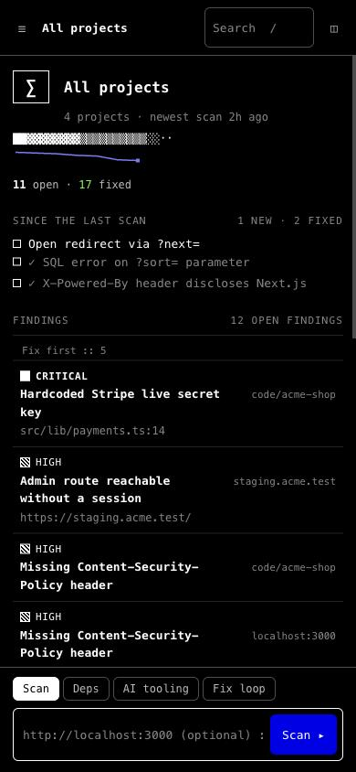
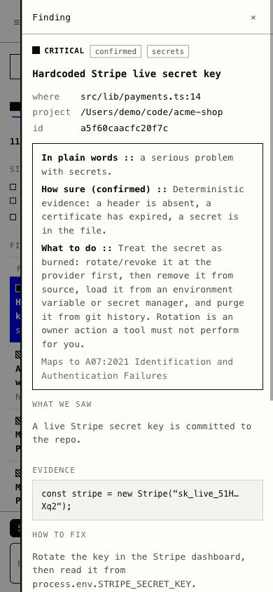
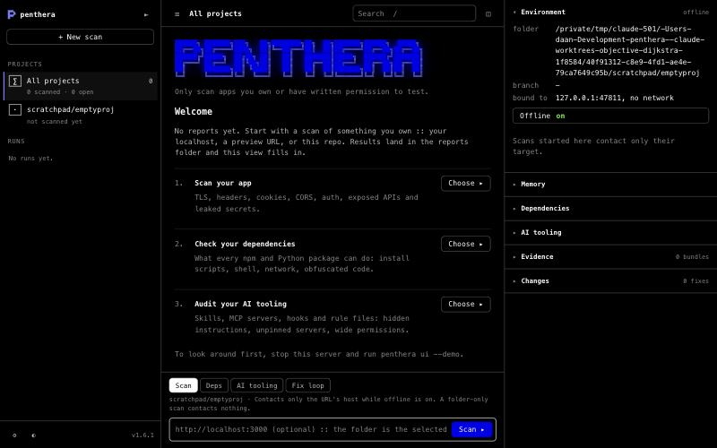
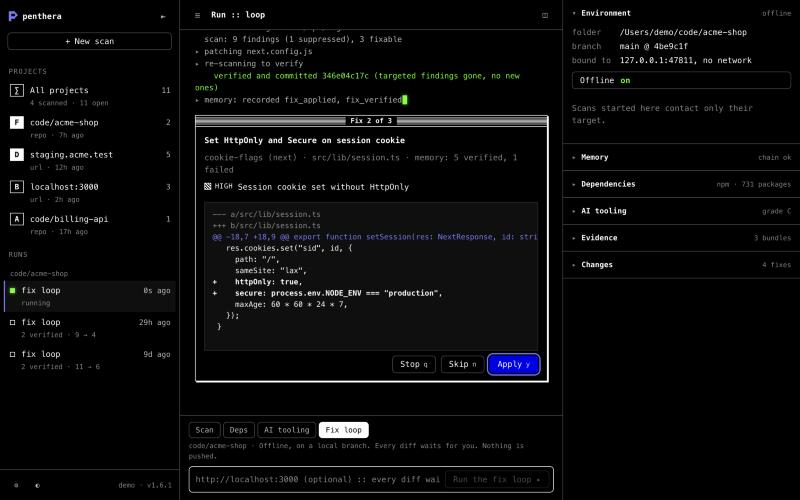

# The local dashboard: `penthera ui`

`penthera ui` opens one view in your browser for what Penthera knows about
your projects, laid out like the Claude Code desktop app: projects and runs on
the left, the selected project or run in the middle, and details on the right.
It can also run scans and the fix loop for you, stopping at every diff. It runs
on `127.0.0.1` only, reads only the folders you give it and `~/.penthera`, and
never contacts the network.

| Dark | Light |
|---|---|
|  |  |

## Start it

```bash
penthera ui --open                       # current folder, reports in ./reports
penthera ui --project ~/code/shop --project ~/code/api --reports ~/code/shop/reports
penthera ui --demo                       # fake data, nothing read from disk
```

| Option | Default | What it does |
|--------|---------|--------------|
| `--port <n>` | `0` (random free port) | Port on 127.0.0.1 |
| `--open` | off | Open the one-time URL in your browser |
| `--project <dir>` | the current folder | A folder the dashboard may read and run in. Repeat for more |
| `--reports <dir>` | `<first project>/reports` | Where report JSON is read from, and where runs started here write theirs |
| `--demo` | off | Realistic fake data and a scripted fix loop. For a first look, screenshots and docs |

It prints a URL with a one-time token. Open it once: the token is swapped for
a session cookie and stops working, so a second browser (or a link that leaked
into history) gets a 403. Restart `penthera ui` for a new link. Ctrl-C stops
the server.

## The view

**Left sidebar** (`[` to hide or show). "+ New scan" on top. Then every
project with its A to F grade, open findings and last scan, with "All
projects" first; project folders you passed with `--project` show up even
before their first scan. Below them, recent runs grouped by project, like the
session list in Claude Code: live runs from this session (a green dot while
running) and past fix-loop runs from the reports folder. The gear in the
footer opens settings; the half-moon switches the theme.

**Centre.** One scrolling stream for what you selected:

- a project (or all of them): a compact header with the grade, a severity bar
  drawn in 1-bit shades, the trend sparkline and open vs fixed; what changed
  since the last scan (new and fixed); then the findings, "Fix first"
  (critical and high) before the rest. `/` searches, `j` and `k` move through
  findings and open each one on the right.
- a run: its output streams in as a transcript, typed out as it arrives. Each
  diff of the fix loop appears inline as a small dialog: the recipe, the files,
  what memory knows about the recipe, the diff, and Apply (`y`), Skip (`n`) or
  Stop (`q`).
- a past fix-loop run: rebuilt from its `loopRun` file, round by round, with
  each fix's decision, result and commit.

At the bottom, a prompt-style bar starts things: **Scan** (with an optional
URL), **Deps**, **AI tooling** or **Fix loop**, always for the selected
project's folder. These are plain controls, not a chat: there is no model
behind them. There is one primary button on screen at a time; while a run is
going, its dialog owns it and the bar waits.

**Right panel** (`]` to hide or show). Stacked cards, each one collapsible:

| Card | What it shows |
|---|---|
| Environment | Offline or online for scans started here (switch it here), the project folder, its git branch and HEAD, and the hosts the last scan contacted (and the ones offline mode blocked) |
| Memory | Chain status, events, verified and failed fixes, median time to fix, recipe success rates |
| Dependencies | Package count and ecosystem, the capability diff against your base, typosquats, capabilities in the tree, install firewall decisions |
| AI tooling | The A to F grade and its history, `penthera.lock` drift, inventory, hidden-content hits |
| Evidence | Create a bundle from the latest scan, download the auditor, owner or developer report, verify any bundle in one click |
| Changes | Fixes the loop committed, with their local commits, and the `penthera/fix-*` branches in the folder |

Picking a finding replaces the cards with its detail: "In plain words" (how
serious, how sure and what that means, what to do, the OWASP mapping), what
was seen, the evidence, sources, and the exact fix-recipe diff with a button
that starts the fix loop on that project. `Esc` goes back to the cards.

Below 1180px the right panel becomes a drawer; below 760px the sidebar does
too. A tap outside closes them.

| Narrow, dark | Narrow, light, a finding open |
|---|---|
|  |  |

## User stories

| Story | Where it lives |
|---|---|
| *As a solo founder before launch, I want to know what to do first when there is no data yet.* | With no reports, the centre shows the wordmark and three steps (scan, dependencies, AI tooling); each focuses the bar on that action.  |
| *As a developer who does not live in the terminal, I want to start a scan from the page and watch it work.* | The bar at the bottom; the run streams into the centre and appears in the sidebar. |
| *As a founder with no security engineer, I want fixes applied only when I approve them.* | The fix loop's inline dialog: Apply, Skip or Stop on every diff; verified fixes land as local commits, failed ones are reverted, nothing is pushed.  |
| *As a product owner, I want one finding explained in plain words.* | Pick it: the right panel opens with "In plain words", the evidence, sources and the fix diff. |
| *As a tech lead after a release, I want to see what changed.* | The project header's sparkline, "Since the last scan" (new, fixed), and the runs in the sidebar. |
| *As the person answering the NIS2 questionnaire, I want evidence an auditor can check.* | The Evidence card: create a bundle, verify it, download the auditor report. |
| *As a developer reviewing a lockfile bump, I want to see what packages gained.* | The Dependencies card: the capability diff and install firewall decisions. |
| *As someone who installs skills and MCP servers, I want to know if any hide instructions or drifted.* | The AI tooling card: grade, hidden content, `penthera.lock` drift. |
| *As someone on a bright screen, I want a light theme.* | The half-moon in the sidebar footer, or Settings; the first visit follows your system. |

## Running things from the page

The bar calls the same functions as the CLI (`executeScan`, `scanDeps`,
`scanAgents`, `runLoop`) with the same rules. The fix loop needs a clean git
tree on a branch, works on a local `penthera/fix-<yyyymmdd-hhmm>` branch, runs
only allow-listed local git commands with hooks off, is always offline with
egress limited to the URL's host, and never pushes. On top of that:

- The project folder must be inside one of the `--project` folders.
- A URL that is not on this machine (anything but `localhost`, `127.x.x.x`,
  `[::1]` and `*.localhost`) needs its hostname typed back before the run
  starts. Only scan what you own or have written permission to test.
- One run at a time. Closing the tab does not stop a run; pick it in the
  sidebar and its transcript replays and continues. Stop finishes the current step, and the fix branch holds only
  verified commits.
- Reports land in the reports folder (`loop-<timestamp>.json`,
  `deps_<timestamp>.json`, and so on), so every screen picks them up.

## Security model

The dashboard is a web server on your machine, so any page open in the same
browser can send it requests. Every request passes, in this order:

1. **Host check.** The `Host` header must be exactly `127.0.0.1:<port>` or
   `localhost:<port>`. This blocks DNS rebinding, where `attacker.example`
   re-resolves to 127.0.0.1 so the attacker's page can read the response. It
   runs before the token check, so a rebinding page cannot even redeem the
   link.
2. **Path check.** No dot segments, encoded dots or slashes, backslashes or NUL
   bytes. Static files come from an allowlist built at startup; no part of a
   request path is ever joined onto a filesystem path.
3. **Session.** The one-time URL token is exchanged for an `HttpOnly;
   SameSite=Strict` cookie and a redirect to `/`, so the token leaves the
   address bar. Every request, static files included, needs the cookie.
   Requests without it are rate-limited (429 with `Retry-After`).
4. **Origin.** Every `POST` needs an `Origin` equal to the server's own (and
   `Sec-Fetch-Site: same-origin` when the browser sends it) and a JSON body, so
   a cross-site form or `fetch` cannot change anything.

Every response carries:

```
Content-Security-Policy: default-src 'self'; script-src 'self'; style-src 'self'; img-src 'self';
  font-src 'self'; connect-src 'self'; object-src 'none'; base-uri 'none'; form-action 'self';
  frame-ancestors 'none'; require-trusted-types-for 'script'
X-Frame-Options: DENY            X-Content-Type-Options: nosniff
Referrer-Policy: no-referrer     Cache-Control: no-store
Cross-Origin-Opener-Policy / -Resource-Policy / -Embedder-Policy
```

There are no CORS headers, and `OPTIONS` gets a 405. The page has no inline
script or style, loads nothing from another host (no CDN, fonts, analytics or
chart library), and never turns data into HTML: finding titles and evidence
come from the sites and repos you scanned, so they are only ever set as text.
Report downloads are served as `text/markdown` attachments from the same
checks; the audience is one of `auditor`, `owner` or `developer`, nothing else.

Penthera scans its own dashboard clean with `--profile standard`, signed in and
not; `tests/ui.test.js` runs that scan on every test run, alongside tests for
the Host check, the token and cookie, Origin, the headers, the rate limit and
path traversal.

## Design

Calm, terminal-native, and close to the Claude Code desktop app: hairlines
instead of boxes, one stream in the middle, details on the side. The 1-bit
register from earlier versions stays in the details: severity as a word plus a
pattern swatch (solid, hatched, half-tone, dotted, empty), bars drawn with the
shade characters `█ ▓ ▒ ░`, the pinstriped title bar on the approval dialog,
and the CLI's `#0000ed` block-letter wordmark on the empty state.

- **One accent.** `#0000ed` marks the primary button, the selected finding,
  links and chart lines. On black it measures 2.2:1, so there it is only a fill
  with white on it (9.5:1), a frame or a glow; text in that hue uses `#7a7aff`
  (6.1:1). On white, `#0000ed` is text-safe (9.3:1). Green is kept for the
  cursor, the prompt and "OK".
- **Both themes pass WCAG AA** for every text node in every state (all
  projects with every card open, a project with a finding open, settings, a
  past run), measured in the browser, composited.
- **Motion.** Run output types itself out and the cursor blinks; with
  `prefers-reduced-motion` both stop and output appears whole. Nothing else
  animates.
- **Keyboard.** `/` search, `j`/`k` findings, `[`/`]` side panels, `y`/`n`/`q`
  answer a diff, `Esc` closes the detail, clears the search or closes a
  drawer. Every control is a real button or link; the approval dialog takes
  focus when a diff arrives; screen readers get each log line whole.
