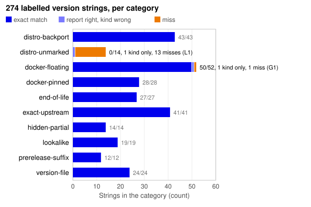

# Runtime strings: a labelled test set for runtime advisories

> **Project page.** For "does Penthera's runtime-advisory check keep its promises on the version strings real servers, images and repos actually contain?"

Penthera 1.8.0 reads `Server` and `X-Powered-By` banners, `PHPSESSID`, Docker
images and version files, and answers per product and advisory: affected, end
of life with no fix, check on server, or has the fix (see
[runtime advisories](../runtime-advisories.md)). It promises two things:

1. A hidden or partial version is never reported as safe.
2. A distribution build is never reported as affected, because distributions
   backport fixes under the old upstream number (Debian Project, n.d.; Red
   Hat, n.d.; Ubuntu Security Team, n.d.).

This set tests both promises on 274 real-world strings for PHP, Apache httpd,
nginx, Node.js, Python, OpenSSL and, since 1.8.1, MongoDB. The first 253
strings cover the six products of 1.8.0. The 21 MongoDB strings were added
when 1.8.1 began reading MongoDB. Every string is labelled by hand from a
primary source. The test runs each string through the real engine and the
bundled `advisories` pack.

- Set: [`bench/runtime-strings/strings.json`](../../bench/runtime-strings/strings.json)
- Test: [`tests/runtime-strings.test.js`](../../tests/runtime-strings.test.js) (part of `npm test`)
- Rows and labeller: [`rows.mjs`](../../bench/runtime-strings/rows.mjs), [`label.mjs`](../../bench/runtime-strings/label.mjs)

**Result, 22 Oct 2026.** The first promise holds on every string. The second
holds on every string that marks itself as a distribution build: 43 of 43.
It does not hold on 14 distribution builds whose string is identical to an
upstream one. Six of those are PHP builds: four are reported as critical and
likely affected, including Ubuntu 24.04's patched `PHP/8.3.6` behind a CDN.
The other two get a critical "end of life, no fix". The set
also found four small engine bugs. All four are fixed and released in 1.8.1
([#101](https://github.com/danoszz/penthera/pull/101),
[#102](https://github.com/danoszz/penthera/pull/102),
[#103](https://github.com/danoszz/penthera/pull/103),
[#106](https://github.com/danoszz/penthera/pull/106)). The L1 mitigation
([#114](https://github.com/danoszz/penthera/pull/114)) lowers those banner
findings to `potential`, with a check-on-server note.

**Limits.** One person wrote the rows and the labeller, the set leans on PHP,
and it holds strings from primary sources, not a sample of real servers. See
[threats to validity](#threats-to-validity) below.

| Record | |
|---|---|
| Built | 2026-10-22, commit [`29808bd`](https://github.com/danoszz/penthera/commit/29808bd) (253 strings, Penthera 1.8.0) |
| Data as measured | `strings.json` at commit [`6e8afff`](https://github.com/danoszz/penthera/commit/6e8afff) (274 strings, Penthera 1.8.1) |
| Status | Part of `npm test`, so every change to the engine or the pack runs it |
| Last reviewed | 2026-10-29 (see [Changes](#changes)) |

## Results

The test prints this table on every run. "Label" means the engine matched the
whole label: evidence kind, every verdict and end of life. "Report" counts
only what the user sees, the verdicts and end of life. A kind-only miss gives
the right findings for the wrong reason.

| Category | 1.8.0: entries | label | report | 1.8.1: entries | label | report |
|---|---:|---:|---:|---:|---:|---:|
| distro-backport | 43 | 100.0% | 100.0% | 43 | 100.0% | 100.0% |
| distro-unmarked | 14 | 0.0% | 7.1% | 14 | 0.0% | 7.1% |
| docker-floating | 43 | 88.4% | 90.7% | 52 | 96.2% | 98.1% |
| docker-pinned | 24 | 100.0% | 100.0% | 28 | 100.0% | 100.0% |
| end-of-life | 23 | 82.6% | 82.6% | 27 | 100.0% | 100.0% |
| exact-upstream | 41 | 100.0% | 100.0% | 41 | 100.0% | 100.0% |
| hidden-partial | 14 | 85.7% | 92.9% | 14 | 100.0% | 100.0% |
| lookalike | 17 | 100.0% | 100.0% | 19 | 100.0% | 100.0% |
| prerelease-suffix | 12 | 0.0% | 58.3% | 12 | 100.0% | 100.0% |
| version-file | 22 | 90.9% | 90.9% | 24 | 100.0% | 100.0% |
| **total** | **253** | **84.6%** | **88.5%** | **274** | **94.2%** | **94.9%** |



*Figure 1. The 1.8.1 columns as counts: per category, strings whose label
the engine matches exactly (blue), whose report is right but evidence kind
is not (light blue), and misses (orange). n = 274 strings, from
[`bench/runtime-strings/strings.json`](../../bench/runtime-strings/strings.json)
as of 2026-10-22. The counts cover a fixed set, not a sample, so the figure
has no intervals. Drawn by
[`figures/runtime-strings.mjs`](figures/runtime-strings.mjs), which fails if
its totals differ from the table.*

The 1.8.0 columns are the engine and pack as released in 1.8.0, on the
original 253 strings. The 1.8.1 columns are main after #101, #102, #103, #106,
#113 and #114, with the 1.8.1 pack and the 21 MongoDB strings. That pack adds
the Node.js security release of 21 October 2026 and MongoDB's end-of-life
dates. On the same 253 strings, 1.8.1 scores 94.1% (label) and 94.5%
(report). The remaining misses are L1 (14) and G1 (2: one nginx and one
MongoDB vendor image).

### What changed between the two runs, per category

Every changed label was checked by hand against the intent of the change
behind it. None is a regression.

- **end-of-life, prerelease-suffix, hidden-partial:** B1, B2 and B3 were fixed,
  so their 19 deviations were removed. The labels themselves did not change.
  The labeller follows #101's rule for pre-releases. A pre-release of the
  fixed version is below it, so affected (`PHP/8.4.27-dev`). One of the
  version after the fix may predate the fix, so check on server
  (`8.4.28-dev`). From two patches on, it has the fix.
- **docker-floating, version-file (Node.js):** B4 was fixed (#106), so its five
  deviations were removed. The 1.8.1 pack also adds two Node.js advisories,
  fixed in 22.23.4, 24.22.1 and 26.12.1, so 28 Node.js entries gained
  verdicts (there were none before):
  - Exact versions at the fix (`node:22.23.4-slim`, `node:24.22.1-alpine`,
    `node:26.12.1`, `.node-version: 22.23.4`) have the fix.
  - The end-of-life lines 14, 16, 18, 20 and 25 (including `node:iron` and
    `lts/hydrogen`) get "end of life, no fix", the rule for any unlisted
    end-of-life line.
  - Floating tags and aliases (`node:24`, `node:lts`, `node:current`,
    `.nvmrc: node`) get check on server.
- **All products, end-of-life findings from banners:** #114 lowers an "end
  of life" finding from a banner with no distribution token to `potential`
  (`Apache/2.2.34 (Unix)`, `PHP/8.1.28`, `nginx/1.27.3`, `OpenSSL/1.1.1w`).
  That is intended. Debian 12's `nginx/1.22.1` prints the same string as
  upstream and is still patched. The labels stay `end-of-life`, not
  `end-of-life-distro`: those strings are not distribution builds, and the
  engine does not report them as such. The test harness had treated any
  end-of-life finding below `likely` as a distribution build. It now reads
  only `needs-human-review` that way. A new test pins #114: every exact
  version from such a banner is at most `potential` and carries the
  check-on-server note, and every exact image or version-file pin stays
  `likely`, unless the advisory has a condition.
- **MongoDB (new in 1.8.1):** 21 strings added after #113 taught the engine
  to read MongoDB. MongoDB has no HTTP banner, so the strings are what the
  engine reads: official `mongo` image tags (each confirmed on Docker Hub,
  22 Oct 2026) and `.tool-versions`. The set keeps its minimum of ten strings
  per product, because these images and pins are where the engine reads
  MongoDB. The minimum is not limited to products with banners. No MongoDB
  advisory is bundled, so the labels are end of life only, against
  MongoDB's lifecycle page as the 1.8.1 pack dates it (22 Oct 2026). All
  match, apart from the vendor image (G1, kind only: no finding either way).
- **distro-unmarked (L1):** these entries are unchanged and still misses. The
  set labels verdicts, and the verdict is still "affected" or "end of life".
  Only the confidence and the note changed, which the new test checks.

By product: PHP 88 entries, Apache httpd 45, Python 36, nginx 33, Node.js 31,
MongoDB 21, OpenSSL 20.

The test passes. Every entry the engine still gets wrong carries a `deviation` that
records what the engine says today. The test checks that the engine still says
exactly that, so the suite stays green and the miss stays on the record. When a
fix lands, that entry fails until its deviation is removed, so each fix shows up
as a change to this table.

## What the set found

| Id | Type | Entries | What goes wrong | Worst case |
|---|---|---:|---|---|
| L1 | limitation | 14 | A distribution build whose string equals an upstream one is read as upstream | `X-Powered-By: PHP/8.3.6` from a patched Ubuntu 24.04 behind a CDN: **critical, likely affected** |
| B2 (fixed, #101) | bug | 12 | `-dev` is read as a distribution build, and `RC`, `rc` or `-beta` as no version | `PHP/8.4.27-dev`, a build from before 8.4.27: **"has the fix"** |
| B1 (fixed, #102) | bug | 5 | `introduced` is ignored on release lines older than the flaw | `Apache/2.2.34`: **critical, "end of life, no fix"** for a flaw that only exists in 2.4.49 and 2.4.50 |
| B4 (fixed, #106) | bug | 5 | Node.js LTS codenames (`lts/iron`, `node:iron`) are not resolved | `.nvmrc: lts/iron` (Node.js 20) is not reported as end of life |
| B3 (fixed, #103) | bug | 2 | `Server: Python/3.9 aiohttp/3.8.6` is ignored, because the Python pattern needs x.y.z | an end-of-life Python 3.9 is not reported |
| G1 | gap | 2 | Only `library/` images are read | `nginxinc/nginx-unprivileged:1.27` and `mongodb/mongodb-community-server:7.0-ubi8` give no evidence |

L1 and B2 break the promises. B1 overstates. B3, B4 and G1 understate, which
the docs allow ("no answer is not a clean bill of health").

### L1: distribution builds that look upstream

This is the main finding. The engine treats a version as a distribution build
in two cases: the version carries a package suffix, or the `Server` header names a
distribution. The research shows how often neither is true:

- **PHP.** Ubuntu 20.04 and 22.04 add the package revision to `PHP_VERSION`
  (`PHP/8.1.2-1ubuntu2.28`), via
  [debian/rules](https://git.launchpad.net/ubuntu/+source/php8.1/plain/debian/rules?h=ubuntu/jammy-updates).
  Ubuntu 24.04 and 26.04 do not
  ([noble rules](https://git.launchpad.net/ubuntu/+source/php8.3/plain/debian/rules?h=ubuntu/noble-updates)),
  so they print `PHP/8.3.6` and `PHP/8.5.4`. Debian 11 and 12 still try to add
  it, but the `sed` matches nothing since PHP 7.4's `configure.ac`. Debian
  stopped trying in 2024
  ([salsa commit](https://salsa.debian.org/php-team/php/-/commit/c53a23122e2e9d01089244cd6933e424004aaa41)).
  RHEL never adds a suffix
  ([php.spec](https://gitlab.com/redhat/centos-stream/rpms/php/-/raw/c9s/php.spec)).
- **nginx.** Only Ubuntu brands nginx (`nginx/1.24.0 (Ubuntu)`,
  [ubuntu-branding.patch](https://git.launchpad.net/ubuntu/+source/nginx/plain/debian/patches/ubuntu-branding.patch?h=ubuntu/noble-updates)).
  Debian and RHEL print plain `nginx/1.22.1` and `nginx/1.20.1`.
- **Python.** `http.server` prints `sys.version.split()[0]`, which has no
  package revision on any distribution.
- **Apache httpd.** This one is safe. Debian and Ubuntu set `ServerTokens OS`
  and the platform from `lsb_release`. EL builds put os-release `NAME` in
  `PLATFORM` ([httpd.spec](https://gitlab.com/redhat/centos-stream/rpms/httpd/-/raw/c9s/httpd.spec)).
  So `Apache/2.4.58 (Ubuntu)` names its distribution, and every PHP version on
  the same response inherits that.

PHP behind Apache on a distribution is therefore handled correctly. PHP-FPM
behind Debian's or RHEL's nginx is not, and neither is any PHP behind a CDN or
with `server_tokens off`. A version string cannot tell `PHP/8.3.6` from Ubuntu
24.04 apart from upstream 8.3.6, so this cannot be fixed from the string. Two
mitigations are possible (see the decisions below).

### B2: pre-releases

`main/php_version.h` on a release branch names the next patch with `-dev`:
`PHP-8.4` says `8.4.28-dev` today
([source](https://github.com/php/php-src/blob/PHP-8.4/main/php_version.h)).
A build from that branch between 8.4.26 and 8.4.27 sends `PHP/8.4.27-dev`. It
does not have the 21 October fix, but the engine strips `-dev`, treats the
rest as a distribution build of 8.4.27, and says it has the fix. RC tags have
no separator (`8.5.0RC1`), so `parseVersion` rejects them. The result is
"check on server", even for 8.6, which no advisory lists. Python's `3.15.0rc1`
gives no evidence, and OpenSSL's `4.1.0-beta2` is read as a distribution build.
Production servers rarely run pre-releases, but CI images and dev containers
do, and "has the fix" is the one answer that must never be wrong.

### B1: `introduced` and older lines

The httpd rule lists one line, `2.4`, fixed in 2.4.51 and introduced in 2.4.49.
For a line the rule does not list, the engine assumes the worst: "whether
the flaw exists on 2.2 is not stated; treat it as affected". That default is
right for PHP's 2026 advisories, which name no `introduced` version. Here the
advisory says the opposite: the flaw only exists in 2.4.49 and 2.4.50. Even
so, `Apache/2.2.34 (Unix)` and `httpd:2.2.34` get a critical "end of life,
no fix" finding for it, and CentOS 6's `Apache/2.2.15 (CentOS)` gets
"check on server". The end-of-life finding itself is correct and stays.

## Fixes

Each was its own small PR with a regression test, released in 1.8.1. When
each landed, its `deviation` entries came out of the rows and `strings.json`
was regenerated.

| Bug | Change | Regression test |
|---|---|---|
| B1, [#102](https://github.com/danoszz/penthera/pull/102) | `verdictFor`: when the version's line has no fix entry, is older than the oldest listed line, and that line's entry has `introduced`, return none | `Apache/2.2.34 (Unix)` gives only the end-of-life finding |
| B2, [#101](https://github.com/danoszz/penthera/pull/101) | `parseVersion`: read `-dev`, `alpha`, `beta`, `RC` (any case, with or without a separator) as a pre-release that sorts below its release, and never as a distribution build. `parseImageRef` takes the same tags. A pre-release of the version after the fix is "check on server" | `PHP/8.4.27-dev` is affected; `PHP/8.4.28-dev` is check on server; `PHP/8.4.29-dev` has the fix; `PHP/8.6.0RC4` gives no advisory verdict |
| B3, [#103](https://github.com/danoszz/penthera/pull/103) | Python banner pattern: accept `Python/x.y` as `branch` evidence | `Python/3.9 aiohttp/3.8.6` is end of life |
| B4, [#106](https://github.com/danoszz/penthera/pull/106) | Node.js: map LTS codenames (`argon` 4 … `krypton` 24) to their line for `.nvmrc` `lts/<name>` and `node:<name>` | `.nvmrc: lts/iron` is end of life |
| L1, not taken (possible follow-up) | Data, not code: a `runtime-distro-version` list in the pack of the frozen upstream version per supported distribution release (Ubuntu 24.04 php 8.3.6, Debian 12 nginx 1.22.1, EL9 php 8.0.30, …), reported as "check on server" with the distribution named | `X-Powered-By: PHP/8.3.6` alone is check on server, naming Ubuntu 24.04 |

A frozen-version list cannot cover a distribution that moves to new upstream
point releases. Debian, for example, ships `php8.2 8.2.35-1~deb12u1`, so its
`PHP/8.2.35` is identical to the upstream version and genuinely fixed. The list
only helps where the number stays fixed for the distribution's life.

## Decisions for the maintainer

Fixes for B1–B4 were separate PRs, all merged: B2
[#101](https://github.com/danoszz/penthera/pull/101), B1
[#102](https://github.com/danoszz/penthera/pull/102), B3
[#103](https://github.com/danoszz/penthera/pull/103) and B4
[#106](https://github.com/danoszz/penthera/pull/106). L1 changed what
Penthera claims, so it went to the maintainer:

1. **L1, decided: cap and explain**, implemented in
   [#114](https://github.com/danoszz/penthera/pull/114). For PHP, Apache
   httpd, nginx, Python and OpenSSL, an "affected" or "end of life" finding
   from a banner with no distribution token is now at most `potential`, with
   a note to check on the server. Severity is unchanged. Official images and
   version files stay `likely`. The set labels verdicts, not confidence, so
   the 14 L1 entries keep their deviation: the verdict is still "affected",
   now at `potential` with the note. Two alternatives were not taken: a pack
   list of frozen distribution versions (a possible follow-up), and "check
   on server" for every unmarked version (it would lose "affected" for
   upstream builds).
2. **Should this set gate releases?**
   - **(a) Recommended.** Yes, as it is now: part of `npm test`, with known
     deviations pinned.
   - (b) Add a floor to `npm run audit:internal` (for example report-match ≥
     88%), so a regression that also changes a deviation still fails.

## How the set was built

1. **Strings, from primary sources only.** These are vendor docs and source
   code (php-src, httpd, nginx, CPython, Werkzeug, aiohttp, Express,
   Next.js, Tomcat, OpenResty, OpenLiteSpeed, HHVM), distribution package archives
   (Launchpad, Debian madison and sources.debian.org, the AlmaLinux and Rocky
   repos, the CentOS vault), the official image library files and the Docker
   Hub tag API (every tag in the set returned 200 on 22 Oct 2026), and
   php.net's release list. Every PHP version in the set is in
   php.net's release JSON; 8.3.34 and 8.4.0 never existed, so they are left out.
   Nothing was scanned: no request went to anyone's server.
2. **Rows by hand.** Each row in `rows.mjs` gives the input, the product, and
   the truth about the string: its kind (`exact`, `distro`, `branch`,
   `present` or `none`) and its upstream version, with the source and a note.
   The kind is the judgement that matters, and it comes from the source, not
   from the engine. For example, `PHP/8.3.6` from Ubuntu 24.04 is `distro`,
   because Ubuntu's php8.3 package is a distribution build.
3. **Verdicts from the published facts.** `label.mjs` derives the verdicts
   for each row from the advisory facts in the pack's JSON (fixed versions,
   `introduced`, end-of-life dates) and the documented verdict table. It does
   not import the engine. It only runs the engine for rows marked with a
   deviation, to record what the engine says instead. The labels were then
   reviewed by hand, and each disagreement with the engine was checked
   against its source before it was classed as a bug, a limitation or a gap.
4. **The test.** It reads only `strings.json`. For each entry it builds the
   evidence the way a scan does: `evidenceFromResponse` for headers, and a
   temporary `Dockerfile` or version file through `evidenceFromRepo`. It
   then runs `matchRuntimeAdvisories` and `verdictFor` with the bundled
   packs. It checks four things: the label (or the pinned deviation); that
   the report's findings follow from the verdicts; the two promises on every
   entry without a deviation; and that `strings.json` is in sync with
   `rows.mjs`.

Labels are relative to the bundled pack: advisories up to 21 Oct 2026, with
end of life judged on the pack's date, 21 Oct 2026. So `OpenSSL/3.4.8` is not
end of life in the set, although OpenSSL 3.4 reached end of life on 22 Oct.
When the pack changes, regenerate with `node bench/runtime-strings/label.mjs`
and review the diff. The open Node.js advisory PR, for instance, will add
verdicts to every Node.js entry.

## Coverage

**Covered.**

- Exact upstream builds on both sides of every bundled fix.
- Every httpd `ServerTokens` level, and nginx's `server_tokens` off, on and
  build.
- `PHPSESSID`, `composer.json` and cut-short banners.
- Distribution builds from Ubuntu 20.04 to 26.04, Debian 11 to 13, EL7 to EL10
  (RHEL, Rocky, Alma, CentOS Stream) and CentOS 6 and 7.
- PHP, Python and OpenSSL pre-releases.
- OpenSSL letter releases including premium 1.1.1zj, and `-fips`.
- Pinned and floating official images, including RC and codename tags.
- `.php-version`, `.nvmrc`, `.node-version`, `.python-version`,
  `.tool-versions` and `runtime.txt`.
- End-of-life lines for all seven products.
- MongoDB (21 strings, since 1.8.1):
  - Pinned and floating `mongo` image tags on supported lines (7.0, 8.0, 8.3,
    9.0) and end-of-life ones (3.6, 4.2, 4.4, 5.0, 6.0, 8.2), including
    Juice Shop's `mongo:4.4.29`.
  - `mongodb` in `.tool-versions` (the asdf-mongodb plugin).
  - Lookalikes: mongo-express and Percona Server for MongoDB.
  - MongoDB Inc.'s own `mongodb/mongodb-community-server` image, which is not
    read (G1).
- Lookalikes: Tomcat, OpenLiteSpeed, IIS, HHVM, OpenResty, Tengine, Angie,
  Cloudflare, LibreSSL, PyPy, phpMyAdmin and Node-RED images, Express and
  Next.js.

**Not covered.**

- Alpine packages: Alpine builds print plain upstream numbers, and whether a
  given `-rN` backports or tracks upstream varies per package.
- Amazon Linux: no primary source for its httpd banner.
- SUSE and FreeBSD.
- Commercial LiteSpeed.
- Ubuntu ESM builds after Ubuntu 20.04's standard support ended.
- Banners rewritten by load balancers.
- `X-Powered-By` with several products.
- Compose files: they use the same image parser as Dockerfiles, which is
  covered.
- Node.js versions inside distribution packages: no input type carries them.

**Constructed, not observed.**

- Some full banners combine real package versions in the documented format:
  the CentOS 7 `Apache/2.4.6 (CentOS) OpenSSL/1.0.2k-fips mod_fcgid/2.3.9
  PHP/5.4.16`, the XAMPP `Apache/2.4.58 (Win64) OpenSSL/3.1.3 PHP/8.2.12`, and
  the `ServerTokens Full` OpenSSL entries on Debian and Ubuntu.
- The cut-short `PHP/8` and `PHP/8.3`: PHP itself always prints the full
  version.
- The Debian and Ubuntu 24.04 PHP behaviour comes from their packaging source
  (debian/rules); it was not observed on a running server.

## Threats to validity

The same person wrote the rows and the labeller, so
a misreading of an advisory would appear in both. The cross-check against
OpenAI's php2shell-checker in
[the case study](case-study-php-2026-10.md#an-independent-cross-check) covers
the PHP 2026 rules independently. The set is weighted towards PHP (88 of 274)
because PHP has four of the five bundled advisories.

The strings were chosen from primary sources to cover each kind of evidence.
They are not a sample of what real servers send, so the percentages describe
this set and say nothing about how often each case occurs in the wild. The
labels are relative to the pack of 21 Oct 2026 (see above), so a later pack
changes them.

## What it means for you

- A banner the scan cannot place is reported as "check on server", never as
  safe. That held on every string.
- A plain banner such as `PHP/8.3.6` may come from a patched distribution
  package. From 1.8.1 such findings are `potential` and say so. Check the
  version on the server before you act on them.
- An image from outside the official library, such as
  `nginxinc/nginx-unprivileged`, gives no evidence today (G1).

## License

The set (`strings.json`, `rows.mjs`, `label.mjs`, this page) is licensed
[CC BY 4.0](https://creativecommons.org/licenses/by/4.0/). The strings are
factual version identifiers quoted from the cited sources. None of those
sources restricts quoting a version number or a header value. The source
code cited is under its own license and is linked, not copied.

## Reproduce

The set needs no network. From a checkout of the repository:

```bash
npm ci
npx vitest run tests/runtime-strings.test.js     # prints the per-category table
node bench/runtime-strings/label.mjs --check     # strings.json matches rows.mjs
node docs/research/figures/runtime-strings.mjs   # redraws Figure 1
```

- The 1.8.0 columns come from the same test at commit `29808bd` (package
  version 1.8.0, 253 strings). Its commit message records 214 of 253 labels
  and 224 of 253 reports matched.
- Not shared: nothing is held back. The set, the labeller, the test and the
  figure script are all in the repository.

## References

Debian Project. (n.d.). *Debian security FAQ*. Retrieved October 21, 2026, from [https://www.debian.org/security/faq](https://www.debian.org/security/faq) ([entry](../references.md#debiansecurityfaq))

MongoDB, Inc. (n.d.). *Software lifecycle schedules*. MongoDB. Retrieved October 22, 2026, from [https://www.mongodb.com/legal/support-policy/lifecycles](https://www.mongodb.com/legal/support-policy/lifecycles) ([entry](../references.md#mongodblifecycles))

Red Hat. (n.d.). *Security backporting practice*. Red Hat Customer Portal. Retrieved October 21, 2026, from [https://access.redhat.com/security/updates/backporting](https://access.redhat.com/security/updates/backporting) ([entry](../references.md#redhatbackporting))

Ubuntu Security Team. (n.d.). *Security/FAQ*. Ubuntu Wiki. Retrieved October 21, 2026, from [https://wiki.ubuntu.com/SecurityTeam/FAQ](https://wiki.ubuntu.com/SecurityTeam/FAQ) ([entry](../references.md#ubuntusecurityfaq))

The distribution packaging sources, image tags and vendor pages that each
string rests on are linked in the text and, per string, in the `source`
field of `strings.json`.

## Changes

- 2026-10-22: the set of 253 strings (`29808bd`); the L1 options and
  decision (`ef92377`, `350e67c`); B1 to B3 fixed (`4a836b2`, `6b89211`);
  relabelled for 1.8.1 (`9172f9a`); 21 MongoDB strings (`6e8afff`).
- 2026-10-29: added the limits line, the record, Figure 1, what it means
  for you, reproduction steps, references that link to the shared
  bibliography, and a note that the set is not a sample. Threats to validity
  became its own section. No result or number changed.
